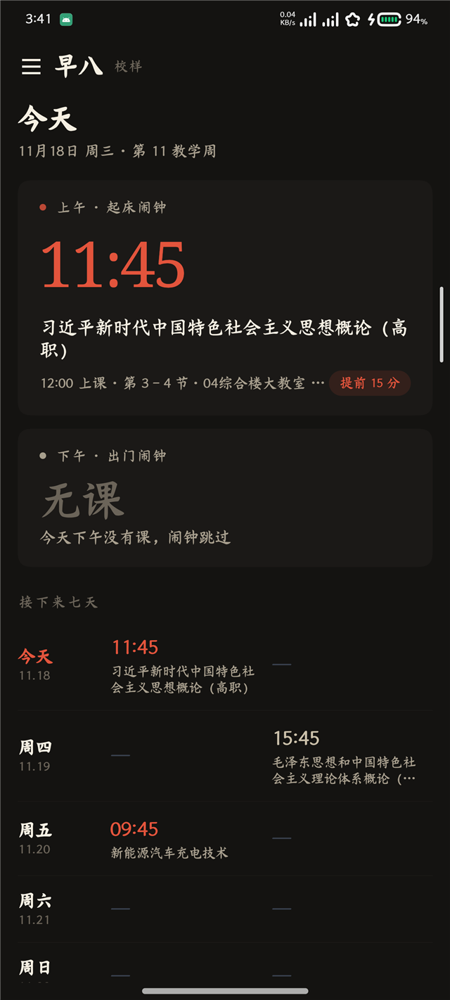
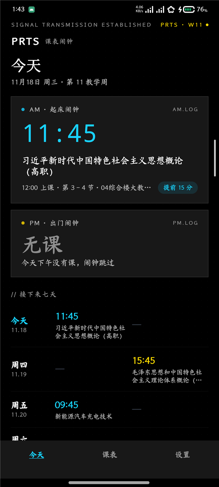
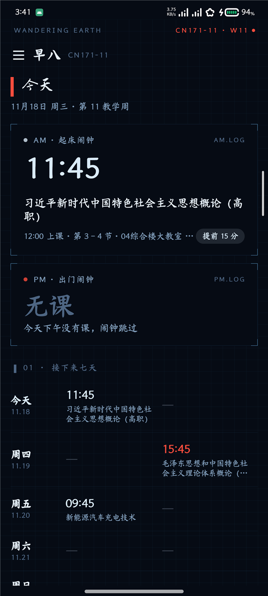
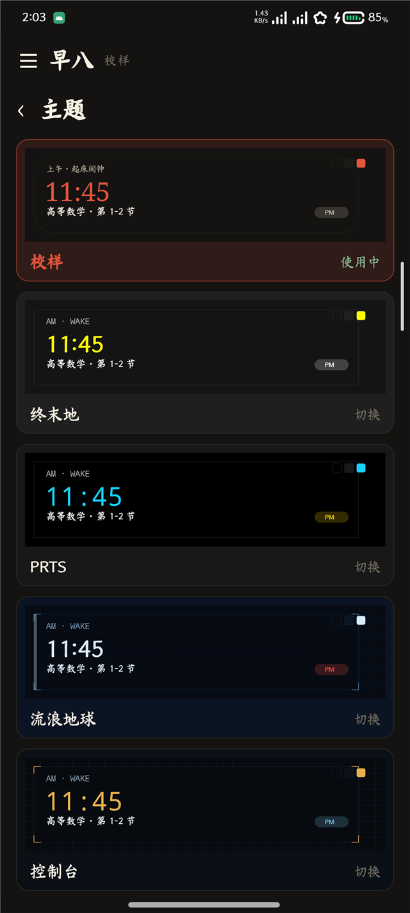

# 早八 · 课表闹钟

> 把课表变成闹钟。导入课表，自动按「当天上午 / 下午最早的那一节课」倒推起床时间，到点全屏响铃。

安卓 App，纯 Java、零第三方依赖、**没有任何网络权限**——课表只存在你本机。

<p align="center">
  
  
  
  
</p>

<p align="center">
  <code>minSdk 24</code> · <code>targetSdk 33</code> · <code>~4 MB</code> · <code>零依赖</code> · <code>无网络权限</code>
</p>

---

## 它解决什么问题

早八的痛不是起不来，是**每天早上都要重新算一遍**：今天第一节课几点？要不要早起？今天是不是停课？

这个 App 把这一步替你做了——课表导进去，之后的每一天都直接告诉你闹钟几点响、响给哪节课。

## 特性

- **三条导入通道**：`.ics` 日历文件 / 纯文本（一行一门课，字段顺序随意）/ 图片（存给识别流程用）；另有 JSON 可一次带入学期、作息表与全部课程
- **单双周、学期起止、停课日**：`1-16/单`、`3-4,6,8` 这类写法都认
- **上下午两套提前量**：洗漱 / 通勤 / 缓冲三段，各自可调，竖向转轮选择
- **三种闹钟方式**：应用全屏闹钟（推荐）/ 系统通知 / 写进系统时钟 App
- **五套主题**：校样（默认）/ 终末地 / PRTS / 流浪地球 / 控制台，卡片形状、导航样式、字体、背景纹理一起换
- **晚自习开关**：第 9-10 节是否参与闹钟，关掉时作息表里也不显示

## 构建

不依赖 Gradle，管线全离线：`aapt2 → javac → d8 → zipalign → apksigner`。

```powershell
cd android
.\build.ps1
```

需要本机有 Android SDK（build-tools + platform）与 JDK，路径写在 `build.ps1` 顶部，按自己的环境改。

产物：`android/早八.apk`（已签名，可直接安装）。

### 签名

签名口令不写进脚本。构建前二选一：

```powershell
# 方式一：环境变量
$env:ZAOBA_KS_PASS = "你的口令"

# 方式二：android\signing.local.ps1（已在 .gitignore 中排除）
$ZaobaKsPass = '你的口令'
```

`build.ps1` 首次运行会用 `keytool` 生成 `zaoba.jks`（口令即上面这个）。**不要提交 `.jks`**，也不要拿同一个口令对外分发——换签名后旧版本无法覆盖安装，需要先卸载。

## 权限说明

| 权限 | 为什么需要 |
| --- | --- |
| `SCHEDULE_EXACT_ALARM` / `USE_EXACT_ALARM` | 精确到点响，不依赖系统批处理。闹钟类应用可申请 `USE_EXACT_ALARM`，安装即授予 |
| `POST_NOTIFICATIONS` | 全屏闹钟靠通知通道拉起，Android 13+ 需要用户授权 |
| `USE_FULL_SCREEN_INTENT` | 锁屏状态下把闹钟界面顶到最前 |
| `RECEIVE_BOOT_COMPLETED` | 重启后重新排闹钟，否则重启一次就再也不响了 |
| `REQUEST_IGNORE_BATTERY_OPTIMIZATIONS` | 引导用户把 App 加入电池优化白名单 |
| `VIBRATE` / `WAKE_LOCK` | 震动与亮屏 |

没有网络、没有存储、没有定位、没有通讯录。

## 兼容性

- **minSdk 24**（Android 7.0）起，无原生库，任何 ABI 都能装
- **targetSdk 33**：这个值是有意的。targetSdk 34+ 之后 `USE_FULL_SCREEN_INTENT` 默认变为拒绝，需要额外引导用户开启；33 能保证装上即用
- 界面全部用 dp 与运行时构造，不依赖固定分辨率

### 闹钟失灵的真正原因

不是代码问题，是**厂商的后台清理**。安装后请在「设置 → 权限」里把三件事做完：

1. 通知、精确闹钟已允许（App 会显示状态）
2. 加入电池优化白名单
3. 自启动 / 后台弹出界面（`自启动 / 后台弹出` 按钮会尝试跳到各品牌的设置页，覆盖小米、华为/荣耀、OPPO/realme、vivo/iQOO、魅族、三星、乐视、华硕；找不到就退到应用详情页）

各品牌叫法不同，大致是：小米「自启动 + 省电策略无限制」、华为「应用启动管理 → 手动管理」、OPPO「允许自启动 + 允许后台运行」、vivo「后台启动权限 + 高耗电保护」。

## 字体

流浪地球主题的中文标题使用 **钟齐志莽行书（Zhi Mang Xing）**，OFL 授权，可免费商用与再分发，文件在 `android/assets/fonts/ZhiMangXing-Regular.ttf`（约 3.9 MB，占了包体绝大部分）。

只作用于页面大标题；品牌名与正文保持系统无衬线——书法体在 18sp 以下会糊。

若要进一步瘦身，可用 fonttools 做子集化（只保留用到的几百个字），能把包体压回 1 MB 以内。

## 已知限制

- 「系统时钟」模式依赖各 ROM 的时钟 App 处理 `SET_ALARM`，`SKIP_UI` 在小米上实测静默生效，其他品牌可能弹出时钟界面
- 只排「下一次」闹钟，响过之后再排下一个；若系统长期不给后台执行机会，可能出现空档
- 主题切换后页面会重建（`recreate()`），当前滚动位置不保留

## 目录

```
android/                     安卓工程（无 Gradle，手动打包）
  assets/fonts/              随包字体
  src/com/zaoba/alarm/
    MainActivity             四页界面 + 抽屉导航 + 设置
    AlarmActivity            全屏闹钟
    AlarmReceiver            闹钟广播 → 通知 + 拉起全屏
    AlarmScheduler           排序下一次闹钟
    Planner                  周次 / 单双周 / 首节课 / 倒推时刻
    Store                    SharedPreferences + JSON
    TextParse / Ics          两种导入解析
    Theme / ThemePreview     主题系统与预览小样
    Hud / Motif / Squircle   绘制层：网格、网点、角标、切角、连续曲率圆角
  build.ps1                  一键出签名 APK
docs/screenshots/            README 用截图
```

## 免责声明

本软件与《明日方舟》《明日方舟：终末地》《流浪地球》的著作权人、商标权人及任何官方机构**均无关联**，未获其授权、认可或赞助。

内置主题（校样 / 终末地 / PRTS / 流浪地球 / 控制台）均为独立的视觉风格设计，仅借鉴配色、形状与排版语言，**未使用上述作品的任何官方素材**——不含立绘、UI 切图、图标、logo、字体或音频。所有图形均由本仓库代码用 Canvas 现绘。

相关名称与商标归各自权利人所有，此处仅用于描述视觉风格。若权利人认为命名方式不当，请在 Issues 中告知，将立即调整。

## 许可

代码以 **MIT** 授权，见 [LICENSE](LICENSE)——保留版权声明即可，商用、闭源衍生都允许。

随包的**钟齐志莽行书**另有授权：SIL OFL 1.1（可免费商用，分发时须附带正文，已放在 ndroid/assets/fonts/OFL.txt）。字体授权独立于 MIT。

第三方素材出处与不含项见 [NOTICE](NOTICE)。

---

作者：[@hate0703](https://github.com/hate0703)
